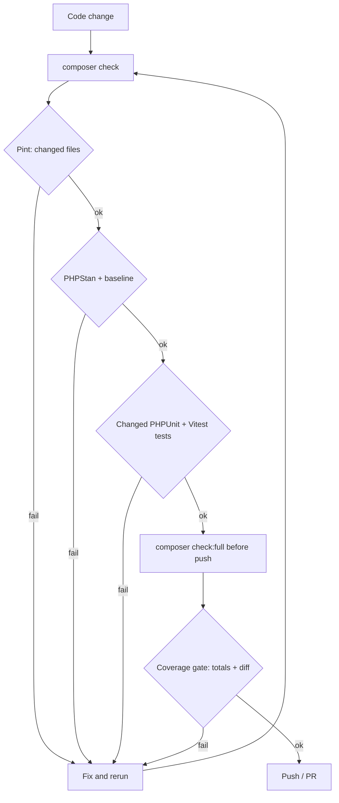

# Quality Gates

Modularous uses a single quality gate for humans, coding agents, git hooks and CI. The same scripts run locally and in GitHub Actions, and every threshold is read from one file, so "green locally" means "green in CI".



## Files

| Path | Role |
|------|------|
| `quality.json` | Thresholds: coverage totals, diff coverage, PHPStan level and baseline cap |
| `bin/agent-check` | Runner with `check` (fast loop) and `full` (pre-push) modes |
| `bin/coverage-gate` | Enforces total and diff coverage, raises thresholds (ratchet) |
| `bin/test-changed` | Maps changed PHP files to their PHPUnit tests |
| `bin/with-coverage-driver` | Picks xdebug or pcov for coverage runs |
| `vue/vitest.config.mjs` | Reads Vue coverage thresholds from `quality.json` |
| `.cursor/rules/quality-gates.mdc` | Always-applied agent rule for the gate |
| `.cursor/hooks/quality-stop.sh` | Cursor `stop` hook running `check` on uncommitted changes |
| `.githooks/pre-push`, `bin/install-hooks` | Git `pre-push` hook running `full`, and its installer |
| `bin/quality-report` | Markdown summary (steps, coverage, diff, PHPStan baseline change) used as the PR comment |
| `.github/workflows/quality.yml` | Reusable CI workflow; the `*-tests.yml` files call it with their Laravel matrix |
| `.agent/last-check.json` | Machine-readable result of the last run (git-ignored) |
| `.agent/logs/<step>.log` | Full output per step (git-ignored) |

## `quality.json`

```json
{
    "php": { "lines": 79.5, "methods": 70 },
    "vue": { "lines": 62.5, "statements": 62.5, "branches": 69, "functions": 33.5 },
    "diff": { "lines": 80, "minChangedLines": 5 },
    "phpstan": { "enabled": true, "level": 8, "baselineMaxErrors": 16583 },
    "ratchet": true,
    "measured": { "date": "2026-10-22", "php": { "...": "..." }, "vue": { "...": "..." } }
}
```

| Key | Meaning |
|-----|---------|
| `php.lines`, `php.methods` | Minimum total PHP coverage (clover statements / methods) |
| `vue.*` | Minimum total Vue coverage; enforced by Vitest `coverage.thresholds` and the gate |
| `diff.lines` | Minimum coverage of **changed** coverable lines since the merge-base with the base ref |
| `diff.minChangedLines` | Diff check is skipped when fewer coverable lines changed |
| `phpstan.enabled` | Runner skips PHPStan while `false` |
| `phpstan.baselineMaxErrors` | Runner fails when `phpstan-baseline.neon` grows beyond this count (`null` disables the cap) |
| `ratchet` | Thresholds only go up; never lower them to make a change pass |
| `measured` | Last measured values, written by `composer quality:ratchet` |

## Commands

| Command | What it does | Typical time |
|---------|--------------|--------------|
| `composer check` | Fast loop: Pint on changed PHP files, PHPStan, changed PHPUnit tests, changed Vitest tests | seconds |
| `composer check:full` | Pint on all files, PHPStan, PHPUnit + Vitest with coverage, coverage gate | ~5 min |
| `composer coverage:gate` | Gate on the existing `coverage-clover.xml` (totals + diff) | < 1 s |
| `composer quality:ratchet` | Raise `quality.json` thresholds to the measured values (rounded down to 0.5) | < 1 s |
| `composer stan` | PHPStan with project config | |
| `composer stan:baseline` | Regenerate `phpstan-baseline.neon` | |
| `composer quality:report` | Markdown summary of the last run (`.agent/last-check.json`, `.agent/coverage-gate.json`) | < 1 s |

Arguments after `--` are forwarded to the runner, for example `composer check -- --base=origin/12.x`.

## `bin/agent-check`

```bash
bin/agent-check [check|full] [--base=<ref>] [--skip=<step,...>] [--keep-going]
```

- **Base ref:** `--base`, else `$QUALITY_BASE`, else `origin/dev`. Falls back to `HEAD` when the ref does not exist. The change set is everything since `merge-base(base, HEAD)` plus staged, unstaged and untracked files.
- **Stops at the first failing step** unless `--keep-going` is given.
- **`--skip`** takes step names, e.g. `--skip=pint,vue-coverage`.

### Steps and exit codes

| Step | Mode | Exit code | Notes |
|------|------|-----------|-------|
| `pint` | both | 10 | `check`: changed PHP files only; `full`: whole repo |
| `phpstan` | both | 20 | Skipped while `phpstan.enabled` is `false`; enforces `baselineMaxErrors` |
| `php-tests` | check | 30 | `bin/test-changed --base=<ref>` |
| `vue-tests` | check | 35 | `vitest run --changed`; full suite when Vitest config, setup or `package.json` changed; skipped without Vue changes |
| `php-coverage` | full | 30 | `composer test:fast:coverage` (paratest, writes `coverage-clover.xml`) |
| `vue-coverage` | full | 35 | `vitest run --coverage` (fails below `quality.json` thresholds) |
| `coverage-gate` | full | 40 | `bin/coverage-gate` totals + diff, writes `.agent/coverage-gate.json` |

Exit code `2` means a usage error.

### `.agent/last-check.json`

```json
{
    "mode": "check",
    "ok": false,
    "exitCode": 10,
    "base": "origin/dev",
    "startedAt": "2026-10-22T13:35:35Z",
    "finishedAt": "2026-10-22T13:35:40Z",
    "steps": [
        {
            "step": "pint",
            "status": "fail",
            "ok": false,
            "durationMs": 649,
            "exitCode": 10,
            "failures": ["...last 40 log lines, ANSI stripped..."],
            "log": ".agent/logs/pint.log"
        },
        { "step": "phpstan", "status": "skip", "ok": true, "durationMs": 0, "reason": "phpstan.enabled is false in quality.json" }
    ]
}
```

`status` is `ok`, `fail` or `skip`. Agents should read `failures` first and open `log` only when the tail is not enough.

## `bin/coverage-gate`

```bash
bin/coverage-gate [--clover=<path>] [--vue=<coverage-final.json>] [--vue-summary=<coverage-summary.json>]
                  [--no-totals] [--diff] [--base=<ref>] [--ratchet-update] [--json] [--output=<path>]
```

- **Totals:** compares clover `statements` / `methods` and the Vue summary against `quality.json`.
- **Diff coverage:** parses `git diff -U0` against the merge-base (plus untracked files) and intersects changed lines with clover `<line type="stmt">` entries and Istanbul `statementMap` start lines. Only lines that are coverable count. Failing output lists uncovered line ranges per file:

```text
[FAIL] diff: 53.85% (7/13 changed lines, threshold 80.00%)
       src/Support/TranslatableMetadata.php: uncovered lines 128-132,134
```

- **Ratchet:** `--ratchet-update` raises each threshold to the measured value rounded down to 0.5 and records `measured`. It never lowers a threshold.
- **Exit codes:** `0` pass, `1` threshold failure, `2` missing or unreadable input.

Diff coverage needs a fresh report. With a stale `coverage-clover.xml` the line numbers no longer match the working tree; `composer check:full` always regenerates it.

## PHPStan setup

| Path | Role |
|------|------|
| `phpstan.neon` | Level, paths (`src`, `modules`, `config`, `database`, `routes`), Larastan config directories, targeted ignores |
| `phpstan-bootstrap.php` | Loads `src/Helpers/*.php` and registers the package providers in Larastan's Testbench app (helpers and providers are otherwise only loaded at runtime) |
| `phpstan-baseline.neon` | Known errors at the current level; must only shrink |

- Package config lives in `config/`, `config/merges` and `config/publishes`, so `configDirectories` points at `config/` for Larastan's `env()` rule.
- `src/Entities/NestedsetCollection.php` is excluded: it extends `Kalnoy\Nestedset\Collection`, but `kalnoy/nestedset` is not a dependency.
- **Same results locally and in CI.** Larastan boots Testbench and resolves facades and macros from the real container, so the environment leaks into the results:
  - Package discovery goes through the `vendor/orchestra/testbench-core/laravel/vendor` → `vendor` symlink, which Larastan creates when missing. If that path is a real directory, no vendor provider is discovered (macros such as `Request::inertia()` go missing); if the symlink is left behind, recursive vendor scans in the test suite (`FinderTest`) loop forever.
  - Always run PHPStan through `bin/stan` (`composer stan`, `composer stan:baseline`, the runner and CI do). It clears that path and the Testbench discovery cache before the run and removes the symlink again on exit.
  - Facade roots that need local files to construct (e.g. `coverage.service` needs `coverage-clover.xml`) must not be the only source of type information; declare `@method` tags on the facade.
  - After changing any of this, clear the result cache (`vendor/bin/phpstan clear-result-cache --memory-limit=2G`) before regenerating the baseline.
- To check that the baseline is reproducible, back it up, reset it to `ignoreErrors: []`, run `composer stan:baseline` and diff against the backup.

## Agent enforcement

Three layers make sure the gate runs even when an agent forgets to call it:

| Layer | File | When it runs | What it does |
|-------|------|--------------|--------------|
| Cursor rule | `.cursor/rules/quality-gates.mdc` | Always applied | Tells the agent to run `composer check` after each change, retry at most 5 times, and lists forbidden workarounds |
| Cursor `stop` hook | `.cursor/hooks.json`, `.cursor/hooks/quality-stop.sh` | When an agent run completes | If tracked paths (`src`, `modules`, `tests`, `vue/src`, …) have uncommitted changes, runs `bin/agent-check check`; on failure sends the failing step and log tail back as `followup_message` (`loop_limit: 3`) |
| Git `pre-push` hook | `.githooks/pre-push` | `git push` | Runs `bin/agent-check full`; a failure aborts the push |

- **Installing the git hook:** `composer install` runs `bin/install-hooks` (`post-install-cmd`), which sets `git config core.hooksPath .githooks`. Run it manually with `composer hooks:install`. It is skipped when `CI` is set, when the package is not its own git checkout (for example under `vendor/`), and when `core.hooksPath` already points somewhere else.
- **Stop hook output:** the runner's console output goes to `.agent/stop-hook.log`; the structured result is the usual `.agent/last-check.json`.
- **Turning the stop hook off temporarily:** start Cursor with `MODULAROUS_SKIP_STOP_HOOK=1`. Agents must not use this or `git push --no-verify`.
- **Parent workspaces:** the hook resolves the package root from its own path, so it also works when Cursor opens a parent project (such as an app that symlinks this package under `packages/`) alongside the package folder.

## CI

`10.x-tests.yml`, `11.x-tests.yml`, `12.x-tests.yml` and `13.x-tests.yml` only define triggers and the Laravel/Testbench matrix, then call `.github/workflows/quality.yml`:

| Job | Runs | Same as locally |
|-----|------|-----------------|
| `pint` | `vendor/bin/pint --test` | `pint` step of `check:full` |
| `phpstan` | `bin/agent-check check --skip=pint,php-tests,vue-tests`; on failure re-runs PHPStan with `--error-format=github` for inline annotations | `phpstan` step incl. baseline cap |
| `phpunit` | `composer test:fast` for every PHP version in `php-versions` | `composer test:fast` |
| `coverage` | `bin/agent-check full --skip=pint,phpstan --base=<diff base>` (PHP 8.3 + pcov, Vitest with coverage), then `bin/quality-report` | coverage steps of `check:full` |

- **Diff base:** `origin/<base branch>` for pull requests, the previous head (`github.event.before`) for pushes, `HEAD~1` as fallback.
- **Report:** the markdown from `bin/quality-report` is written to the job summary and posted as a single PR comment that is updated on every push (not for PRs from forks, whose token is read-only). Reports are uploaded as the `quality-reports-<laravel>` artifact.
- **Dependencies:** `composer.lock` is installed as is. Callers for other Laravel majors set `resolve-matrix: true` so the given `laravel/framework` and `orchestra/testbench` versions are required on top.
- **Inputs:** `php-versions` (JSON array), `laravel`, `testbench`, `resolve-matrix`, `quality-php` (default `8.3`), `node-version` (default `22.x`).
- CI splits the runner into jobs with `--skip`; locally (and for agents) `--skip` must not be used to hide a failing step.

## Rules for contributors and agents

- Run `composer check` after every change and `composer check:full` before pushing.
- Fix failures instead of working around them: do not lower `quality.json` thresholds, do not add new errors to the PHPStan baseline, do not skip, delete or weaken tests.
- Raise thresholds with `composer quality:ratchet` after a `check:full` run that improved coverage, and commit the updated `quality.json`.

## Current status

| Area | Status |
|------|--------|
| Coverage thresholds | Enforced locally (`check:full`, `npm run test:coverage`) |
| PHPStan | Enabled at level 8 with `phpstan-baseline.neon` (16583 errors, capped by `baselineMaxErrors`). Next: shrink the baseline; lower `baselineMaxErrors` whenever fixes reduce it |
| Agent enforcement | Always-applied Cursor rule, Cursor `stop` hook (`check`) and git `pre-push` hook (`full`) |
| CI | Reusable `quality.yml` (Pint, PHPStan, PHPUnit matrix, coverage gate) with a PR comment from `bin/quality-report` |
