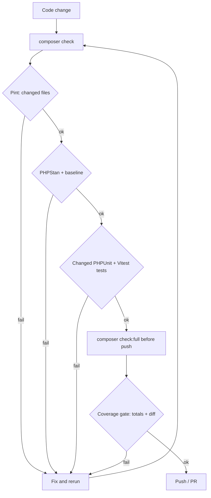

# Quality Gates

Modularous uses a single quality gate for humans, coding agents, git hooks and CI. The same scripts run locally and in GitHub Actions, and every threshold is read from one file, so "green locally" means "green in CI".



## Files

| Path | Role |
|------|------|
| `quality.json` | Thresholds: coverage totals, diff coverage, PHPStan level and baseline cap |
| `bin/agent-check` | Runner with `check` (fast loop) and `full` (pre-push) modes |
| `bin/coverage-gate` | Enforces total and diff coverage, raises thresholds (ratchet) |
| `bin/test-changed` | Maps changed PHP files to their PHPUnit tests |
| `bin/with-coverage-driver` | Picks xdebug or pcov for coverage runs |
| `vue/vitest.config.mjs` | Reads Vue coverage thresholds from `quality.json` |
| `.agent/last-check.json` | Machine-readable result of the last run (git-ignored) |
| `.agent/logs/<step>.log` | Full output per step (git-ignored) |

## `quality.json`

```json
{
    "php": { "lines": 79.5, "methods": 70 },
    "vue": { "lines": 62.5, "statements": 62.5, "branches": 69, "functions": 33.5 },
    "diff": { "lines": 80, "minChangedLines": 5 },
    "phpstan": { "enabled": false, "level": 0, "baselineMaxErrors": null },
    "ratchet": true,
    "measured": { "date": "2026-10-22", "php": { "...": "..." }, "vue": { "...": "..." } }
}
```

| Key | Meaning |
|-----|---------|
| `php.lines`, `php.methods` | Minimum total PHP coverage (clover statements / methods) |
| `vue.*` | Minimum total Vue coverage; enforced by Vitest `coverage.thresholds` and the gate |
| `diff.lines` | Minimum coverage of **changed** coverable lines since the merge-base with the base ref |
| `diff.minChangedLines` | Diff check is skipped when fewer coverable lines changed |
| `phpstan.enabled` | Runner skips PHPStan while `false` |
| `phpstan.baselineMaxErrors` | Runner fails when `phpstan-baseline.neon` grows beyond this count (`null` disables the cap) |
| `ratchet` | Thresholds only go up; never lower them to make a change pass |
| `measured` | Last measured values, written by `composer quality:ratchet` |

## Commands

| Command | What it does | Typical time |
|---------|--------------|--------------|
| `composer check` | Fast loop: Pint on changed PHP files, PHPStan, changed PHPUnit tests, changed Vitest tests | seconds |
| `composer check:full` | Pint on all files, PHPStan, PHPUnit + Vitest with coverage, coverage gate | ~5 min |
| `composer coverage:gate` | Gate on the existing `coverage-clover.xml` (totals + diff) | < 1 s |
| `composer quality:ratchet` | Raise `quality.json` thresholds to the measured values (rounded down to 0.5) | < 1 s |
| `composer stan` | PHPStan with project config | |
| `composer stan:baseline` | Regenerate `phpstan-baseline.neon` | |

Arguments after `--` are forwarded to the runner, for example `composer check -- --base=origin/12.x`.

## `bin/agent-check`

```bash
bin/agent-check [check|full] [--base=<ref>] [--skip=<step,...>] [--keep-going]
```

- **Base ref:** `--base`, else `$QUALITY_BASE`, else `origin/dev`. Falls back to `HEAD` when the ref does not exist. The change set is everything since `merge-base(base, HEAD)` plus staged, unstaged and untracked files.
- **Stops at the first failing step** unless `--keep-going` is given.
- **`--skip`** takes step names, e.g. `--skip=pint,vue-coverage`.

### Steps and exit codes

| Step | Mode | Exit code | Notes |
|------|------|-----------|-------|
| `pint` | both | 10 | `check`: changed PHP files only; `full`: whole repo |
| `phpstan` | both | 20 | Skipped while `phpstan.enabled` is `false`; enforces `baselineMaxErrors` |
| `php-tests` | check | 30 | `bin/test-changed --base=<ref>` |
| `vue-tests` | check | 35 | `vitest run --changed`; full suite when Vitest config, setup or `package.json` changed; skipped without Vue changes |
| `php-coverage` | full | 30 | `composer test:fast:coverage` (paratest, writes `coverage-clover.xml`) |
| `vue-coverage` | full | 35 | `vitest run --coverage` (fails below `quality.json` thresholds) |
| `coverage-gate` | full | 40 | `bin/coverage-gate` totals + diff, writes `.agent/coverage-gate.json` |

Exit code `2` means a usage error.

### `.agent/last-check.json`

```json
{
    "mode": "check",
    "ok": false,
    "exitCode": 10,
    "base": "origin/dev",
    "startedAt": "2026-10-22T13:35:35Z",
    "finishedAt": "2026-10-22T13:35:40Z",
    "steps": [
        {
            "step": "pint",
            "status": "fail",
            "ok": false,
            "durationMs": 649,
            "exitCode": 10,
            "failures": ["...last 40 log lines, ANSI stripped..."],
            "log": ".agent/logs/pint.log"
        },
        { "step": "phpstan", "status": "skip", "ok": true, "durationMs": 0, "reason": "phpstan.enabled is false in quality.json" }
    ]
}
```

`status` is `ok`, `fail` or `skip`. Agents should read `failures` first and open `log` only when the tail is not enough.

## `bin/coverage-gate`

```bash
bin/coverage-gate [--clover=<path>] [--vue=<coverage-final.json>] [--vue-summary=<coverage-summary.json>]
                  [--no-totals] [--diff] [--base=<ref>] [--ratchet-update] [--json] [--output=<path>]
```

- **Totals:** compares clover `statements` / `methods` and the Vue summary against `quality.json`.
- **Diff coverage:** parses `git diff -U0` against the merge-base (plus untracked files) and intersects changed lines with clover `<line type="stmt">` entries and Istanbul `statementMap` start lines. Only lines that are coverable count. Failing output lists uncovered line ranges per file:

```text
[FAIL] diff: 53.85% (7/13 changed lines, threshold 80.00%)
       src/Support/TranslatableMetadata.php: uncovered lines 128-132,134
```

- **Ratchet:** `--ratchet-update` raises each threshold to the measured value rounded down to 0.5 and records `measured`. It never lowers a threshold.
- **Exit codes:** `0` pass, `1` threshold failure, `2` missing or unreadable input.

Diff coverage needs a fresh report. With a stale `coverage-clover.xml` the line numbers no longer match the working tree; `composer check:full` always regenerates it.

## Rules for contributors and agents

- Run `composer check` after every change and `composer check:full` before pushing.
- Fix failures instead of working around them: do not lower `quality.json` thresholds, do not add new errors to the PHPStan baseline, do not skip, delete or weaken tests.
- Raise thresholds with `composer quality:ratchet` after a `check:full` run that improved coverage, and commit the updated `quality.json`.

## Current status

| Area | Status |
|------|--------|
| Coverage thresholds | Enforced locally (`check:full`, `npm run test:coverage`) |
| PHPStan | Disabled in the runner: analysis stops with internal errors because package helpers (e.g. `modularousConfig()`) are not bootstrapped. Config fix and baseline are next, then a level-by-level climb towards level 8+ |
| Agent enforcement | Planned: always-applied Cursor rule, Cursor `stop` hook and git `pre-push` hook calling the runner |
| CI | Planned: reusable workflow calling the same runner and `bin/coverage-gate` instead of inline thresholds |
